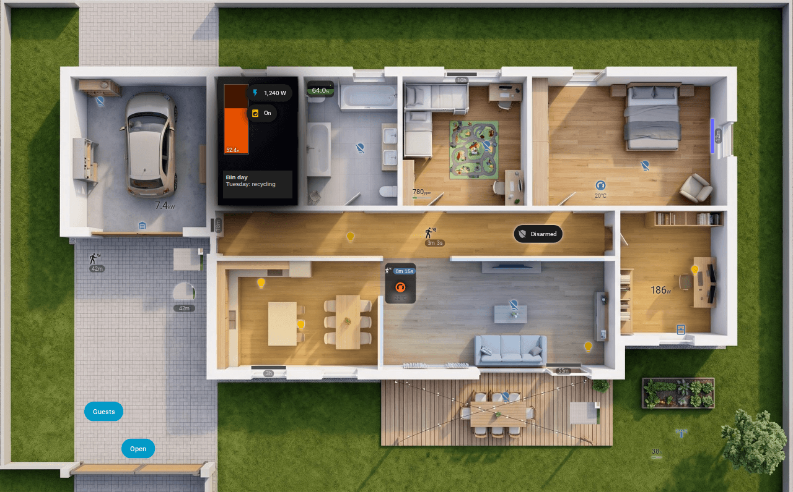
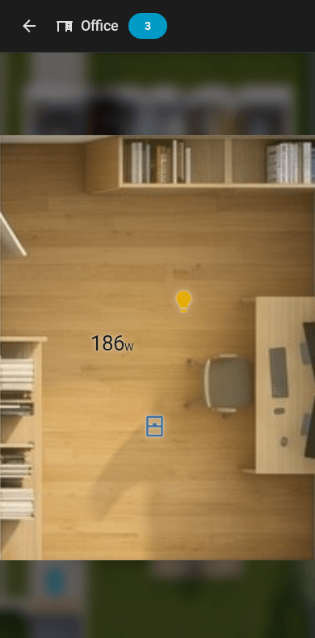

# Scalable House Plan

<p align="center">
  <b>Your floor plan as a live, tappable map of your home, for Home Assistant.</b><br>
  <a href="https://scarfsail.github.io/hass-scalable-house-plan/">Manual</a> ·
  <a href="https://scarfsail.github.io/hass-scalable-house-plan/getting-started/">Getting started</a> ·
  <a href="https://scarfsail.github.io/hass-scalable-house-plan/demo/">Try the demo</a>
</p>

---

Scalable House Plan is a Lovelace card. Give it a picture of your floor plan, outline the rooms, and it puts your lights, sensors, doors, windows, thermostats and cameras where they really are. Rooms glow when someone is in them or the lights are on, and a tap opens a room in detail.



*Willow Lane, the demo house: the hallway and kitchen lights are on, a bedroom window is open and someone is in the living room.*

<table>
<tr>
<td width="50%" valign="top">

**The whole house at a glance.** The plan scales to fit the card, and every room carries what matters in it: light icons, temperatures, door and window bars with the time since they last changed, motion with a live counter.

**Rooms that light up.** Motion, lights and ambient lights each tint the room in their own colour.

**A room in detail.** Tap a room to see it full size with its elements larger. A badge counts the room's other entities, which open as standard Home Assistant tiles.

**Built from your areas.** Link a room to a Home Assistant area and it takes the area's name, icon and entities.

</td>
<td width="50%" valign="top">



</td>
</tr>
</table>

**Fifteen element types,** from state icons and sensor gauges to a thermostat control, gate buttons, cameras, info boxes and groups. **Rooms as dashboards** turn a room into a dark wall screen for readings. **A visual editor** lets you drag room corners and elements on the picture. Made for wall tablets and phones: pinch to zoom, and updates throttled to keep busy houses smooth.

## Install

1. HACS → ⋮ → **Custom repositories** → add `https://github.com/Scarfsail/hass-scalable-house-plan`, type **Dashboard**.
2. Install **Scalable House Plan** and reload the browser.
3. Copy your floor plan picture to `config/www/` and add the card:

```yaml
type: custom:scalable-house-plan
image: /local/house.png
image_width: 1600
image_height: 995
rooms: []
```

Then follow [your first plan](https://scarfsail.github.io/hass-scalable-house-plan/getting-started/first-plan/) in the manual, or load the complete [Willow Lane demo](https://scarfsail.github.io/hass-scalable-house-plan/demo/).

The card is in English, and in Czech when Home Assistant is set to Czech.

## Documentation

The [manual](https://scarfsail.github.io/hass-scalable-house-plan/) covers installation, the concepts, every element and option, and [development](https://scarfsail.github.io/hass-scalable-house-plan/reference/development/).
