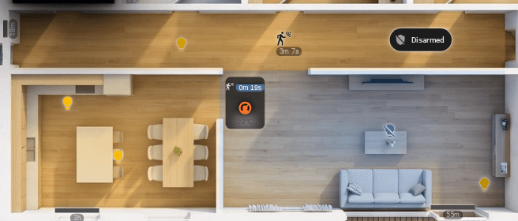

# Dynamic room colours

Each room is tinted by what is happening in it, with a soft glow from its centre:

{ .shot }

*Willow Lane: the kitchen lights are on (warm yellow); someone is moving in the living room (blue, pulsing).*

## What colours a room

The first state that applies wins:

| Priority | State | Default colour |
| --- | --- | --- |
| 1 | **Motion or occupancy**: a motion sensor is on, or turned off less than `motion_delay_seconds` ago; or an occupancy sensor is on. The room pulses. | light blue `rgba(135, 206, 250, 0.20)` |
| 2 | **Lights**: a light is on. | warm white `rgba(255, 245, 170, 0.20)` |
| 3 | **Ambient lights**: only lights marked `light: ambient` are on. | soft purple `rgba(220, 180, 255, 0.20)` |
| 4 | **Idle**: nothing of the above. | transparent; with `show_idle_overlay: true`, grey `rgba(100, 100, 100, 0.20)` |

The room follows the lights, motion sensors (`binary_sensor` with device class `motion`) and occupancy sensors (device class `occupancy`) **listed in the room**, including group children. Entities that only come from the room's [area](rooms-and-areas.md) do not colour it.

Mark a light as ambient in its plan, so a lamp or LED strip left on in the evening gives a gentler tint than the main light:

```yaml
- entity: light.living_room_floor_lamp
  plan:
    left: 400
    top: 160
    light: ambient
```

## Options

All under `dynamic_colors` in the card:

```yaml
dynamic_colors:
  motion_delay_seconds: 120
  motion_occupancy: "rgba(90, 170, 255, 0.45)"
  lights: "rgba(255, 205, 90, 0.45)"
  ambient_lights: "rgba(210, 150, 255, 0.40)"
```

| Option | Default | Meaning |
| --- | --- | --- |
| `motion_occupancy` | `rgba(135, 206, 250, 0.20)` | Colour for motion and occupancy. |
| `lights` | `rgba(255, 245, 170, 0.20)` | Colour for lights. |
| `ambient_lights` | `rgba(220, 180, 255, 0.20)` | Colour for ambient lights. |
| `default` | `rgba(100, 100, 100, 0.20)` | Colour for idle rooms, used only with `show_idle_overlay`. |
| `motion_delay_seconds` | `60` | How long a room stays "in motion" after the sensor turns off. |
| `show_idle_overlay` | `false` | Tint idle rooms with `default`. |
| `show_border` | `false` | Draw the room outlines. |

Colours are best given as `rgba()`: the alpha is the strength of the glow at the room's centre, fading to a quarter of it at the edges. The defaults are subtle; brighter pictures need stronger values, as in Willow Lane.

## Opting out

- `disable_dynamic_color: true` on a **room** keeps it transparent.
- `disable_dynamic_color: true` in an **entity's** `plan` leaves that entity out of the colour (say, a night light that should not tint the bedroom).
- [Dashboard rooms](../dashboards.md) are never tinted.
- `show_room_backgrounds: true` (card option) replaces the dynamic colours by each room's fixed `color`, which helps while drawing outlines.
