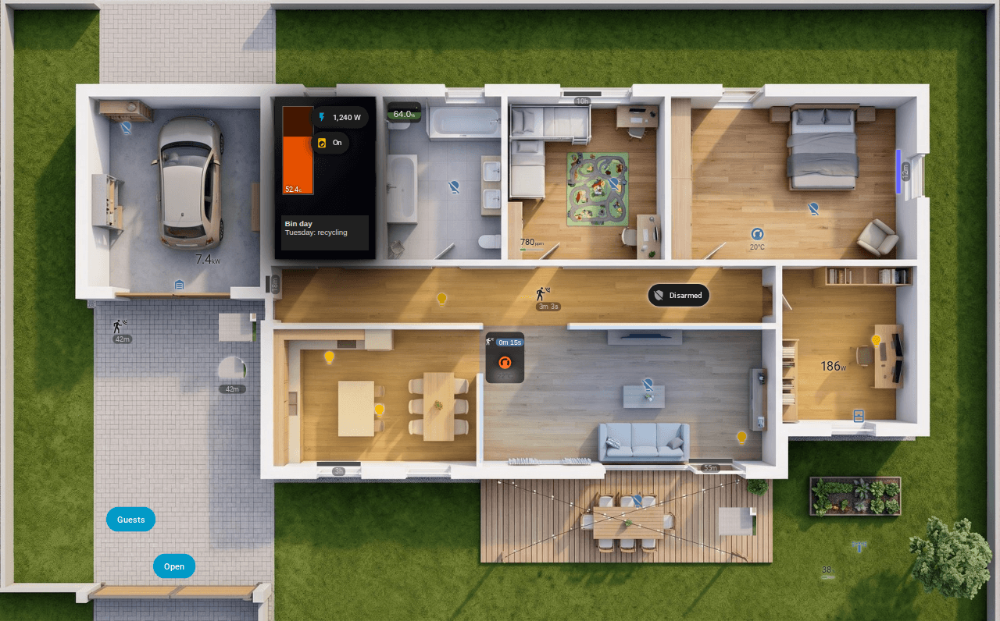
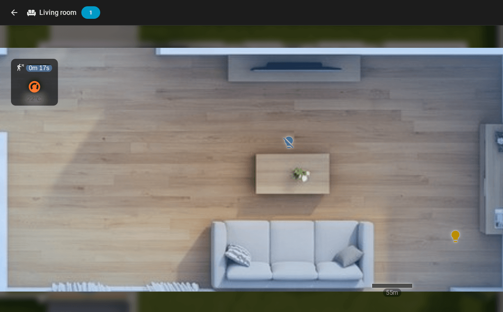
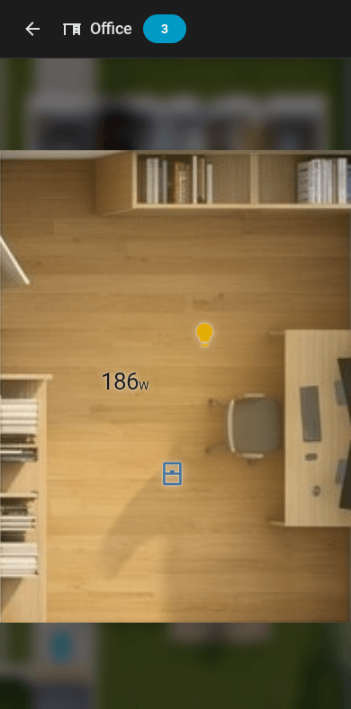
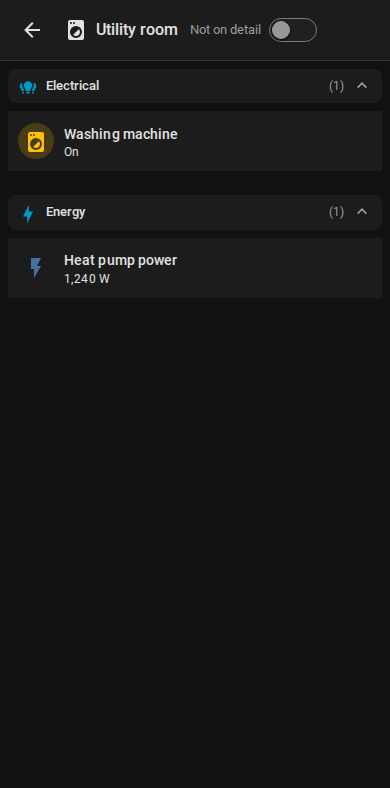

# Overview, room detail and entities

The card has three views. You move between them by tapping; the browser's back button (or the back gesture on a phone) steps back.

## Overview

The whole plan, scaled to fill the card. Every room shows the elements you placed with `plan` (unless an element sets `overview: false`), and glows with its [dynamic colour](dynamic-colors.md).

{ .shot }

Tapping a room opens its detail. On a phone or tablet you can pinch to zoom the overview up to 5× and pan with one finger while zoomed; on a computer, ++ctrl++ + scroll zooms.

The overview stretches the picture to the card's width and height independently, so in a panel view keep the card roughly in the picture's proportions (a landscape screen for a landscape plan), or use [`min_scale` and `max_scale`](../reference/card-options.md) to limit it. On a phone held upright, a landscape plan is squeezed sideways:

{ .shot .shot--narrow }

## Room detail

The room on its own, scaled as large as fits while keeping its proportions, over a blurred overview. The header shows the room's icon and name, a back arrow, and a badge with the number of the room's entities that are not on the plan.

{ .shot }

{ .shot }

Elements in the detail are larger than on the overview: how much larger is set by the [element scaling ratio](positioning.md#element-scaling-in-the-room-detail). Elements hidden on the overview (`overview: false`) appear here. Tapping outside the room closes the detail.

A room with [`detail_view`](../reference/room-options.md) opens that Home Assistant view instead of its detail.

## Entities view

Tapping the badge in the room's header lists the room's entities as standard Home Assistant tiles, grouped into categories (electrical, doors and windows, environment, security, cameras, climate, covers, energy, automations, other). Each category can be collapsed.

{ .shot .shot--narrow }

The entities are the ones listed in the room's `entities` plus every entity of its [area](rooms-and-areas.md). Entities that only appear inside a [group](../elements/group.md) or [badges](../elements/badges.md) element are listed when they belong to the area. The toggle at the top switches between:

- **Not on detail** (the default): only entities that are neither placed on the plan nor shown in an [info box](../elements/info-box.md).
- **All**: every entity of the room.

The badge counts the **Not on detail** entities; it turns grey at zero.
