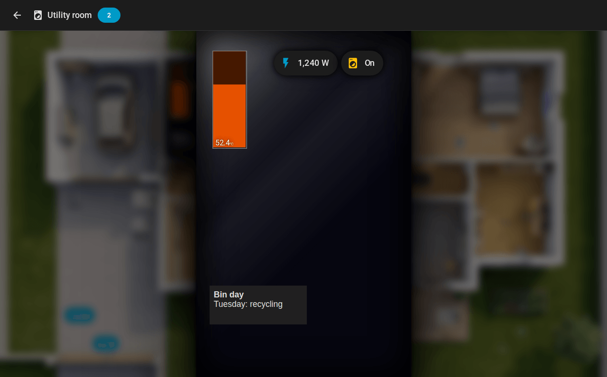

# Rooms as dashboards

A room can render as a dark screen instead of a piece of the floor plan: a panel for readings, badges and notes, drawn as if a display hung on the wall. Willow Lane's utility room shows the hot water tank, the heat pump and the washing machine this way.

{ .shot }

```yaml
- name: Utility room
  area: utility_room
  show_as_dashboard: true
  dashboard_glare: lcd
  dashboard_overview_opacity: 85
  boundary: [[440, 155], [600, 155], [600, 415], [440, 415]]
  entities:
    - entity: sensor.hot_water_tank_temperature
      plan:
        left: 12
        top: 15
        element:
          type: custom:analog-bar-shp
          min: 20
          max: 70
          width: 48
          height: 140
```

A dashboard room:

- is filled black, inside its outline, on the overview and in the detail, with a soft dark vignette along the edges,
- gets a glare highlight on top, chosen with `dashboard_glare`,
- always uses the light-on-dark [readability style](concepts/positioning.md#readability-mode), whatever the card's `readability_mode`,
- is never tinted by [dynamic colours](concepts/dynamic-colors.md).

| Option | Default | Meaning |
| --- | --- | --- |
| `show_as_dashboard` | `false` | Render the room as a screen. |
| `dashboard_glare` | `top-center` | The glare: `top-center` (overhead reflection), `left-center` (lit from the left), `full` (a radial sweep from the centre) or `lcd` (a diagonal sun reflection from the top left). |
| `dashboard_overview_opacity` | `100` | How opaque the screen is on the overview, in percent: `0` shows the floor plan through it, `100` is solid black. The detail is always solid. |

## Opening a Home Assistant view instead

Any room, dashboard or not, can open another Home Assistant view when tapped instead of its room detail, with `detail_view`:

```yaml
- name: Utility room
  detail_view: dashboard-home/heating
```

The value is the view's path as it appears in the browser's address bar after the host, with or without the leading `/`: `dashboard-home/heating` opens the `heating` view of the `dashboard-home` dashboard. While the dashboard is in edit mode the room detail opens as usual, so you can still edit it.
