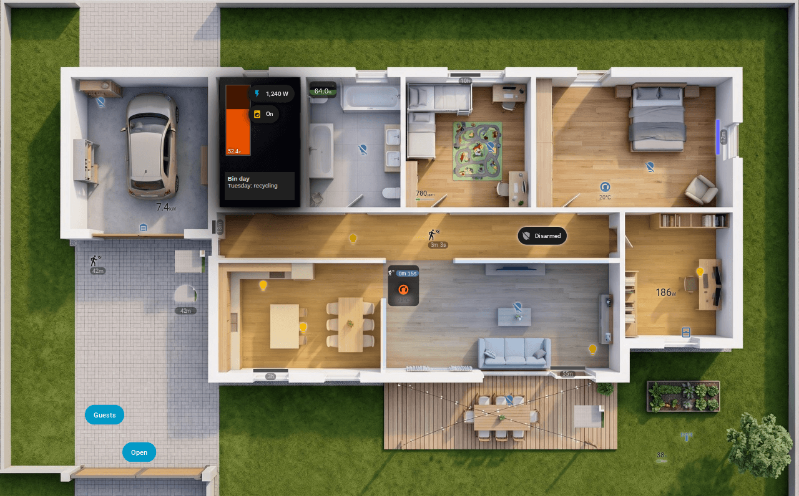

# Try the demo

Every picture in this manual shows **Willow Lane**, an invented single-storey bungalow with a garden. Its floor plan and complete card configuration are part of the repository, so you can load the same plan on your own Home Assistant and take it apart.

{ .shot }

## Files

| File | What it is |
| --- | --- |
| [`willow-lane.jpg`](https://raw.githubusercontent.com/Scarfsail/hass-scalable-house-plan/main/docs/demo/willow-lane.jpg) | The floor plan, 1600 × 995 px. |
| [`willow-lane.yaml`](https://github.com/Scarfsail/hass-scalable-house-plan/blob/main/docs/demo/willow-lane.yaml) | The card configuration: 12 rooms and every element type. |
| [`willow-lane-states.json`](https://github.com/Scarfsail/hass-scalable-house-plan/blob/main/docs/demo/willow-lane-states.json) | The house's invented entities, areas and devices with their states, as used for the screenshots. |

## Load it

1. Download `willow-lane.jpg` and copy it to `config/www/` on your Home Assistant (it is then served as `/local/willow-lane.jpg`).
2. Create a dashboard view of type **Panel**, add a **Manual** card and paste the contents of `willow-lane.yaml`.

The plan appears straight away. Its entities (`light.kitchen_ceiling`, `cover.driveway_gate`…) don't exist in your Home Assistant, so the elements show "Entity not found" until you replace the entity IDs with your own; the room outlines and the dashboard room work as they are. The rooms reference areas such as `living_room`; rooms whose area you don't have simply use their `name`.

## What to look at

| Room | Shows |
| --- | --- |
| Driveway | [Gate buttons](elements/gate-buttons.md), a [script button](elements/scripts-buttons-group.md), a [camera](elements/camera.md), an [image with its age](elements/image-last-change.md), a [motion sensor](elements/motion-sensor.md); elements tappable on the overview. |
| Garage | [State icons](elements/state-icon.md) for the door and light, an [analog value](elements/analog.md) in kW. |
| Hallway | The front door as a [door bar](elements/door-window.md), motion, the alarm as a [badge](elements/badges.md). |
| Utility room | A [dashboard room](dashboards.md) with an [analog bar](elements/analog.md#analog-bar), [badges](elements/badges.md) and an [iframe](elements/iframe.md). |
| Bathroom | An [info box](elements/info-box.md) with humidity; the extractor fan only in the [entities view](concepts/views.md#entities-view). |
| Kids' room | A CO₂ value with a custom [gauge](elements/analog.md#gauge). |
| Main bedroom | A [climate](elements/climate.md) control and an open window. |
| Kitchen & dining | An [ambient light](concepts/dynamic-colors.md). |
| Living room | An info box with motion and the thermostat, the terrace door. |
| Office | A [group](elements/group.md) of the desk lamp, power and window. |
| Terrace, Garden | A second camera, an irrigation switch, soil moisture with a gauge. |

The card also sets [`element_defaults`](concepts/element-defaults.md) and stronger [`dynamic_colors`](concepts/dynamic-colors.md).

## Where the picture came from

The floor plan is an AI-generated render (Google Gemini), made from a [layout sketch](https://github.com/Scarfsail/hass-scalable-house-plan/blob/main/docs/demo/layout-reference.png) and the prompt kept in [`docs/demo/prompt.md`](https://github.com/Scarfsail/hass-scalable-house-plan/blob/main/docs/demo/prompt.md). A render like this is one way to get a good-looking plan of your own home: sketch the rooms, describe the furniture, and trace the room outlines on the result.
