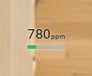
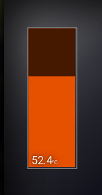

# Analog, analog bar and gauge

## Analog

`custom:analog-shp`

A sensor's value and unit, with the unit in small type. It is the default for every `sensor` entity; temperature, humidity, power and energy sensors get 20 px text.

{ .shot }

```yaml
- entity: sensor.ev_charger_power
  plan:
    left: 170
    top: 250
    element:
      shorten_and_use_prefix: k     # 7360 W → 7.4 kW
      decimals: 1
```

| Option | Default | Meaning |
| --- | --- | --- |
| `decimals` | `1` | Decimal places shown. |
| `shorten_and_use_prefix` | | Divide large values and prefix the unit: `dynamic` (k, M, G, T as needed, from 1000 up), or a fixed `k`, `M`, `G` or `T`. |
| `negate` | `false` | Show the value with the opposite sign (for meters that count export as negative, say). |
| `gauge` | | A gauge with the value, see [below](#gauge). |

## Gauge

`gauge` adds a coloured bar to an analog value. `gauge: true` uses a preset picked from the sensor's device class: `battery` (0–100 %, red below 15, orange below 30, green), `humidity` (0–100 %, orange below 30, green, blue from 65) or, for temperature, `temperature_indoor` (18–27 °C, blue, green from 22, orange from 24, red from 26). Other device classes need a range of their own:

```yaml
- entity: sensor.kids_room_co2
  plan:
    left: 20
    top: 225
    element:
      gauge:
        min: 400
        max: 2000
        thresholds:            # colour from each value up
          - value: 400
            color: "#4CAF50"
          - value: 1000
            color: "#FF9800"
          - value: 1500
            color: "#F44336"
```

| Option | Default | Meaning |
| --- | --- | --- |
| `preset` | from the device class | `battery`, `humidity`, `temperature_indoor`, `temperature_outdoor` (−20–40 °C) or `temperature_pool` (25–35 °C). |
| `min`, `max` | from the preset | The range the bar spans. |
| `thresholds` | from the preset | `value` / `color` pairs; the bar takes the colour of the highest threshold the value reaches. |
| `color` | | A fixed colour, or a JavaScript template (`"[[[ return entity.state > 50 ? 'red' : 'green' ]]]"`) that overrides the thresholds. |
| `style` | `bars` for temperature and humidity, else `bar` | `bar`: one bar filled to the value. `bars`: one bar per hour of history, with the current value painted behind the text. |
| `bars` | `24` | Hours of history with `style: bars`. |
| `encoding` | `height-color` for `bars`, else `color` | With `bars`, `height-color` makes each bar's height follow its value; `color` keeps them full height. |
| `bar_gap` | `1` | Pixels between history bars. |
| `text_background` | `true` for `bars`, else `false` | Paint the current value's colour behind the text. |
| `position` | `top` for `bars`, else `bottom` | Where the bar sits: `top`, `bottom`, `left`, `right` or `background` (behind the text). |
| `height` | `4` | Bar thickness in pixels. |
| `width` | | Width of the gauge (pixels or a CSS length). |
| `gap` | `0` for `bars`, else `4` | Pixels between text and bar. |
| `text_position` | `end` | Text alignment when the gauge is wider than the text: `start`, `center` or `end`. |

The history bars read hourly statistics (or the history, for sensors without statistics) from the recorder.

## Analog bar

`custom:analog-bar-shp`

A vertical bar filled to the value between `min` and `max`, with the value written on it. Willow Lane's hot-water tank uses it, with a colour that turns orange when the water is hot:

{ .shot }

```yaml
- entity: sensor.hot_water_tank_temperature
  plan:
    left: 12
    top: 15
    element:
      type: custom:analog-bar-shp
      min: 20
      max: 70
      width: 48
      height: 140
      active_color: "[[[ return +entity.state >= 45 ? '#e65100' : '#1e88e5' ]]]"
```

| Option | Default | Meaning |
| --- | --- | --- |
| `min`, `max` | (required) | The range. |
| `width`, `height` | (required) | Size in pixels. |
| `active_color` | `#404854` | Colour of the filled part; a colour or a JavaScript template. |
| `bg_color` | `rgba(0, 0, 0, 0.7)` | Colour of the empty part. |
| `border_color` | `gray` | Border colour. |
| `font_size` | `11` | Text size in pixels; `0` hides the value. |
| `value_position` | `bottom` | Where the value is written: `bottom` (at the foot of the bar), or `scaleTop` / `scaleBottom`, which move it with the fill level. |
| `decimals`, `shorten_and_use_prefix`, `negate` | | As for analog. |

## JavaScript templates

Options marked as templates accept a JavaScript function body between `[[[` and `]]]`. It runs in the browser with `entity` (the element's state object), `states` (all states), `hass` and `user`, and returns the value.
