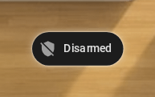
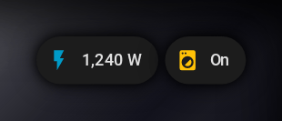

# Badge and badges

Home Assistant's entity badges (the rounded pills from the top of a dashboard view), placed on the plan.

## Badge

`custom:badge-shp`

One badge for the element's entity. Willow Lane shows the alarm in the hallway this way:

{ .shot }

```yaml
- entity: alarm_control_panel.home
  plan:
    left: 600
    top: 25
    element:
      type: custom:badge-shp
```

Every other option in `element` is passed to the badge, so the options of Home Assistant's [entity badge](https://www.home-assistant.io/dashboards/badges/) work here: `name`, `icon`, `color`, `show_name`, `show_state`, `show_icon`, `show_entity_picture`, `state_content` and the actions.

## Badges

`custom:badges-shp`

A row of badges for several entities, wrapping onto more lines when they don't fit. It has no entity of its own:

{ .shot }

```yaml
- entity: ""
  plan:
    left: 58
    top: 15
    element:
      type: custom:badges-shp
      entities:
        - sensor.heat_pump_power
        - switch.washing_machine
```

| Option | Default | Meaning |
| --- | --- | --- |
| `entities` | (required) | The entity IDs, one badge each. |
| `show_name` | `false` | Show each entity's name. |
| `show_state` | `true` | Show each entity's state. |
| `show_entity_picture` | `false` | Show the entity picture instead of the icon. |

The visual editor has a form for the badge list.
