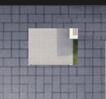

# Camera

`custom:camera-shp`

The camera's live picture (Home Assistant's camera stream), at a fixed size. It is the default for `camera` entities: 60 × 45 px on the plan. A tap opens the camera's more-info dialog.

{ .shot }

```yaml
- entity: camera.driveway
  plan:
    left: 200
    top: 20
    element:
      width: 96
      height: 72
```

| Option | Default | Meaning |
| --- | --- | --- |
| `width` | `60` | Width in pixels. |
| `height` | `45` | Height in pixels. |

Every camera on the plan keeps a stream open while the card is shown. For many cameras or a slow network, consider placing them with `overview: false`, so they stream only while their room is open.

In the [entities view](../concepts/views.md#entities-view), cameras are shown 300 × 225 px.
