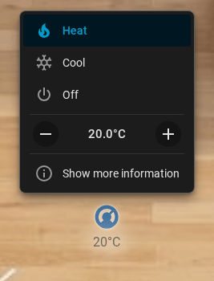

# Climate

`custom:climate-shp`

A thermostat: the climate entity's state icon with its target temperature underneath. Tapping it opens a menu to switch the HVAC mode, step the target temperature up and down, choose a fan mode, or open the more-info dialog. It is the default for `climate` entities.

{ .shot }

```yaml
- entity: climate.main_bedroom
  plan:
    left: 120
    top: 200
    element:
      hvac_modes: [heat, off]
```

| Option | Default | Meaning |
| --- | --- | --- |
| `hvac_modes` | `[heat, cool, off]` | HVAC modes offered in the menu, as far as the entity supports them. They are listed in Home Assistant's usual order. |
| `fan_modes` | `[Auto, Quiet]` | Fan modes offered in the menu, as far as the entity supports them. The names must match the entity's `fan_modes` exactly. |

The +/− buttons change the target by the entity's temperature step and show the new value straight away; the menu stays open while you tap.

By default a thermostat that is **off** is hidden on the overview (`overview_active_only` defaults to `true` for climate entities, see [positioning](../concepts/positioning.md#showing-on-the-overview)); in the room detail it is always shown.

A climate entity listed in a room without a plan position appears in the room's [info box](info-box.md) instead, as the same control.
