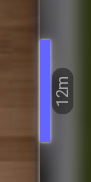

# Door and window

`custom:door-window-shp`

A bar drawn on the wall: grey while closed, blue while open, with the time since it last opened or closed. Place it over the door or window in the picture. It is the default for `binary_sensor` entities with the device class `door`, `window` or `garage_door`.

{ .shot }

```yaml
- entity: binary_sensor.main_bedroom_window
  plan:
    left: 362
    top: 85
    element:
      width: 70
      orientation: vertical
```

| Option | Default | Meaning |
| --- | --- | --- |
| `width` | `27` door, `20` window, `40` garage door | Length of the bar along the wall, in pixels. |
| `height` | `7` | Thickness of the bar. |
| `orientation` | `vertical` door, `horizontal` window and garage door | `horizontal` for a wall running left–right, `vertical` for one running up–down. |
| `text_position` | `end` | Which side of the bar the time goes: `end` (below a horizontal bar) or `start` (above it). On a vertical bar the label is turned to run along the bar. |
| `text_align` | `center` | Where along the bar the time sits: `start`, `center` or `end`. |
| `unobtrusive` | `false` | Draw an open door in the plan's text colour instead of blue. |

The time since the last change is highlighted for the first seconds after a change, so a door that just opened stands out.

If you use [Alarmo](https://github.com/nielsfaber/alarmo) and the sensor belongs to an Alarmo area, a closed door or window is drawn red while that area is armed and green while it is disarmed.
