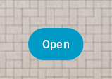

# Gate buttons

`custom:gate-buttons-shp`

Buttons that drive a cover (a gate, a garage door, a blind) and change with its state:

| Cover state | Buttons |
| --- | --- |
| closed | **Open** |
| open, at position 100 | **Close** |
| opening | **Stop**, **Close** |
| closing | **Stop**, **Open** |
| open at any other position, or without a position attribute | **Open**, **Close** |
| anything else | the state as text |

{ .shot }

```yaml
- entity: cover.driveway_gate
  plan:
    left: 95
    top: 405
    element:
      type: custom:gate-buttons-shp
      orientation: horizontal
```

| Option | Default | Meaning |
| --- | --- | --- |
| `orientation` | vertical | `horizontal` puts two buttons side by side; otherwise they are stacked. |

The buttons call `cover.open_cover`, `cover.close_cover` and `cover.stop_cover` directly. To use them from the overview without opening the room, set `elements_clickable_on_overview: true` on the room (see [actions](../concepts/actions.md#on-the-overview)).
