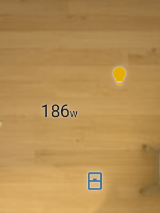

# Group

`custom:group-shp`

A box that holds several elements, positioned inside it. Move the group and its children move along; in the visual editor you drag the whole group or each child. The element has no entity of its own. Willow Lane's office groups the desk lamp, the office's power use and its window:

{ .shot }

```yaml
- entity: ""
  plan:
    left: 40
    top: 60
    element:
      type: custom:group-shp
      width: 130
      height: 190
      children:
        - entity: light.office_desk
          plan:
            left: 90
            top: 40
        - entity: sensor.office_power
          plan:
            left: 20
            top: 90
            element:
              decimals: 0
        - entity: binary_sensor.office_window
          plan:
            left: 62
            top: 160
            element:
              type: custom:state-icon-shp
```

| Option | Default | Meaning |
| --- | --- | --- |
| `width`, `height` | `100` | Size of the box, in pixels. |
| `children` | (required) | Entries exactly like a room's `entities`. Child positions are pixels from the group's top-left corner. |
| `show_border` | `false` | Draw a dashed border around the box, handy while laying it out. |

- A child gets its element the same way a room's entity does ([which element an entity gets](index.md#which-element-an-entity-gets)), but not the house-level [`element_defaults`](../concepts/element-defaults.md).
- On the overview a child appears only if it has a `plan` and doesn't set `overview: false`.
- Groups can be nested.
- The group removes `width` and `height` from its children's element options, so elements that need a size ([door and window](door-window.md) bars, [cameras](camera.md), [iframes](iframe.md)) don't show inside a group. Willow Lane shows the office window as a state icon there.
- Children count as the room's own entities for [dynamic colours](../concepts/dynamic-colors.md) and the [info box](info-box.md).

The visual editor has a form for groups.
