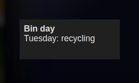

# Iframe

`custom:iframe-shp`

A web page embedded in the plan at a fixed size: a weather widget, a status page, a short note. The element has no entity of its own.

{ .shot }

```yaml
- entity: ""
  plan:
    left: 10
    top: 190
    element:
      type: custom:iframe-shp
      width: 140
      height: 56
      src: "data:text/html,<body style='margin:0;padding:6px;font:12px sans-serif;background:%23202020;color:%23ddd'><b>Bin day</b><br>Tuesday: recycling</body>"
```

| Option | Default | Meaning |
| --- | --- | --- |
| `src` | (required) | The page's address. Willow Lane uses a `data:` URL so the demo needs no web server; in a URL, write `#` as `%23`. |
| `width`, `height` | (required) | Size in pixels. |

The page must allow being embedded (many websites don't), and on an `https` Home Assistant it must be `https` too.
