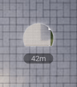

# Image last change

`custom:image-last-change-shp`

A round thumbnail of an image entity (a doorbell snapshot, the last motion picture of a camera) with the time since the picture last changed. It is the default for `image` entities.

{ .shot }

```yaml
- entity: image.driveway_snapshot
  plan:
    left: 200
    top: 90
    element:
      size: 44
```

| Option | Default | Meaning |
| --- | --- | --- |
| `size` | `50` | Diameter of the thumbnail, in pixels. |

The thumbnail is drawn by Home Assistant's picture-elements image, so its other options can be set as well, such as `image` (a fixed picture instead of the entity's) or `state_image` (a picture per state).
