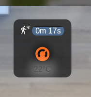

# Info box

`custom:info-box-shp`

A compact panel with the room's readings: motion, occupancy, temperature, humidity and the thermostat, collected automatically. Place one in a room and it finds the matching entities among the room's entities, its group children and its [area](../concepts/rooms-and-areas.md). The element has no entity of its own.

{ .shot }

```yaml
- entity: ""
  plan:
    left: 10
    top: 10
    element:
      type: custom:info-box-shp
```

## What it shows

Rows appear in this order, one per matching entity:

| Row | Entities | Shown as |
| --- | --- | --- |
| `motion` | binary sensors with device class `motion` | the time since the last change |
| `occupancy` | binary sensors with device class `occupancy` | the time since the last change |
| `temperature` | sensors with device class `temperature` | the value with a gauge |
| `humidity` | sensors with device class `humidity` | the value with a gauge |
| `climate` | `climate` entities | the [climate](climate.md) control |

Tapping a row opens that entity's more-info dialog (the climate row opens its own menu). To keep an entity out of the info box, set `exclude_from_info_box: true` in its `plan`.

Entities shown in an info box are counted as "on the detail": they are left out of the room's [entities view](../concepts/views.md#entities-view) in its default mode.

## Options

| Option | Default | Meaning |
| --- | --- | --- |
| `show_background_overview` | `true` | Dark background behind the box on the overview. |
| `show_background_detail` | `true` | Dark background behind the box in the room detail. |
| `types` | | Settings per row type (`motion`, `occupancy`, `temperature`, `humidity`, `climate`), below. |

Per row type, under `types.<type>`:

| Option | Default | Meaning |
| --- | --- | --- |
| `visible_overview` | `true` | Show these rows on the overview. |
| `visible_detail` | `true` | Show these rows in the room detail. |
| `overview_active_only` | `true` for climate, else `false` | On the overview, show the row only while the entity is active (a thermostat that is not off). |
| `icon_visibility` | `detail` | Where the leading icon is shown: `detail`, `overview` or `all`. |
| `icon_position` | `inline` | `inline` puts the icon beside the value, `separate` above it. |
| `size` | `"100%"` | Size of the value, e.g. `"150%"`. |
| `element` | | Options passed to the element drawing the value, e.g. `{decimals: 0}` for temperature or `{gauge: false}` to drop the gauge. |

```yaml
element:
  type: custom:info-box-shp
  show_background_overview: false
  types:
    temperature:
      size: "150%"
      element:
        decimals: 0
    humidity:
      visible_overview: false
```

An info box is the typical element to configure once for the whole house with [`element_defaults`](../concepts/element-defaults.md); each room's box then only needs its position.
