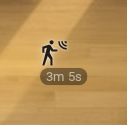

# Motion sensor

`custom:motion-sensor-shp`

A motion icon with the time since the sensor last changed, counting up live. It is the default for `binary_sensor` entities with the device class `motion` or `occupancy`.

{ .shot }

```yaml
- entity: binary_sensor.hallway_motion
  plan:
    left: 420
    top: 30
```

| Option | Default | Meaning |
| --- | --- | --- |
| `hide_icon` | `false` | Show only the time, without the icon. |

- An **occupancy** sensor that is on turns the icon amber and the time label into a pulsing blue pill.
- The time is highlighted for 15 seconds after each change.
- With [Alarmo](https://github.com/nielsfaber/alarmo), the icon of a sensor in an Alarmo area is red while the area is armed and green while it is disarmed.

Motion in a room also makes the whole room pulse with its [dynamic colour](../concepts/dynamic-colors.md). The room's [info box](info-box.md) can show its motion sensors too, so a sensor doesn't need its own element.
