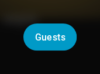

# Script buttons group

`custom:scripts-buttons-group-shp`

A set of buttons that each run a script. While one of the scripts runs, the buttons give way to a panel saying which script is running, the script's `last_action` attribute, and a button that stops it, labelled **Cancel** and the script's title (for example **Cancel Guests**). The element has no entity of its own.

{ .shot }

```yaml
- entity: ""
  plan:
    left: 20
    top: 330
    element:
      type: custom:scripts-buttons-group-shp
      scripts:
        - entity: script.open_gate_for_guests
          title: Guests
          left: 0
          top: 0
```

| Option | Default | Meaning |
| --- | --- | --- |
| `scripts` | (required) | The buttons: each has the script's `entity`, the button's `title`, and its `left` / `top` offset in pixels from the element's position. |
| `running_left`, `running_top` | `0` | Offset of the "running" panel, in pixels. |
| `running_width`, `running_height` | `200`, `100` | Size of the "running" panel, in pixels. |

A button calls `script.turn_on`; **Cancel** calls `script.turn_off`.
