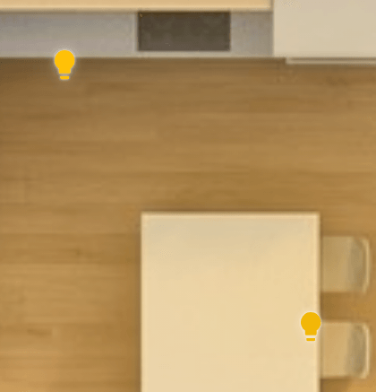

# State icon

`custom:state-icon-shp`

The entity's icon, coloured by its state the way Home Assistant colours it everywhere else: a light that is on glows in its colour, a closed cover is grey. It is the default for lights, switches, fans, locks, covers and every entity without a more specific element.

{ .shot }

```yaml
- entity: light.kitchen_ceiling
  plan:
    left: 150
    top: 110
- entity: light.kitchen_under_cabinet
  plan:
    left: 70
    top: 25
    light: ambient
```

The icon is Home Assistant's own state icon, so it follows the entity's icon, colour and tap/hold [actions](../concepts/actions.md) (lights toggle on hold).

## Options

| Option | Default | Meaning |
| --- | --- | --- |
| `title` | | A small label under the icon. Setting it turns `show_title` on. |
| `show_title` | `false` (`true` with `title`) | Show a label under the icon: `title`, or the entity's name. |
| `show_trigger_info` | `false` | Instead of the title, a letter showing what last changed the entity: **A** an automation (orange), **U** a user (blue), **M** anything else (grey). |
