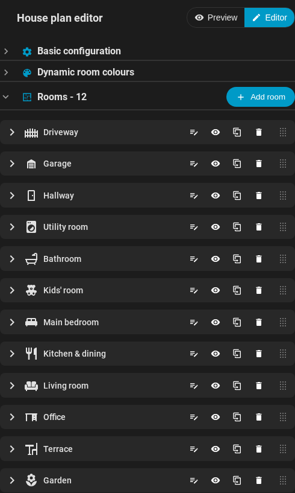
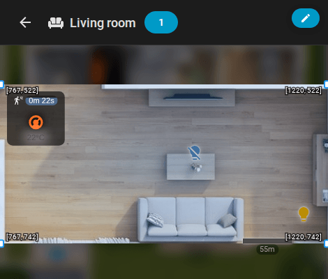

# The visual editor

Open the dashboard's edit mode and edit the card. The card's own editor fills the left side of the dialog; the right side shows the live card.

{ .shot .shot--narrow }

The header switches between two modes:

- **Editor** (the default): the preview is interactive. Click an element to select it, drag it to move it, and edit a room's outline with handles.
- **Preview**: the preview behaves like the real card, so taps open rooms and entities.

## Basic configuration

The first section holds the card-level options: the picture (URL, width, height), the [readability mode](../concepts/positioning.md#readability-mode), minimum and maximum scale, the [element scaling ratio](../concepts/positioning.md#element-scaling-in-the-room-detail), room backgrounds, real-time updates and the [dynamic room colours](../concepts/dynamic-colors.md). Every option is described in the [card options reference](../reference/card-options.md).

## Rooms

The **Rooms** section lists the rooms; **Add room** adds one, and rooms can be reordered by dragging. Expanding a room shows:

- its **area** (optional) and **name**; with an area the room takes the area's name,
- the room options (elements clickable on the overview, disable dynamic colour, show as dashboard, detail view),
- **Room size and shape**: the outline's points as X/Y fields, with **Add point**,
- **Entities / Elements**: what the room shows, each with an optional **Plan** section (where it sits) and an **Element** section (which element and its options).

Each room and each element has a YAML toggle to edit it as text, and a duplicate button.

## Room outline handles

The eye icon on a room opens that room's detail in the preview. In **Editor** mode the outline has a handle on every corner:

{ .shot }

| Action | What it does |
| --- | --- |
| Drag a handle | Moves that corner. A ghost outline shows the result until you let go. |
| ++ctrl++ + drag a handle | Copies the corner: a new point is inserted and dragged, the original stays. |
| Click a handle | Selects it. |
| Arrow keys | Move the selected corner by 1 pixel. |
| Type a number | Starts typing the selected corner's X coordinate; ++tab++ moves on to Y, ++enter++ saves. |
| ++delete++ or ++backspace++ | Removes the selected corner (a room keeps at least 3). |
| ++escape++ | Cancels a drag or a typed coordinate. |

## Adding and dragging elements

**Add entity / element** in a room adds a row. Pick the entity; to place it on the plan, fill in the **Plan** section (at least `left` and `top`). For an element without an entity (an [info box](../elements/info-box.md), a [group](../elements/group.md), [badges](../elements/badges.md)…) choose **No entity** and set the element type.

In **Editor** mode, drag any element in the preview to move it, on the overview or in a room's detail. The new position is written back to the element's `plan` in picture pixels. ++escape++ during a drag puts the element back.

!!! note
    The editor writes the same YAML you would write by hand, so you can mix both: lay out rooms visually, then fine-tune in YAML.
