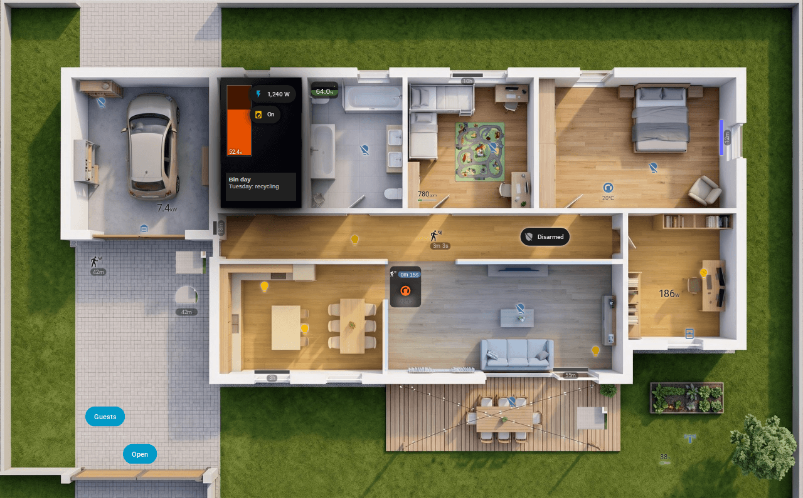
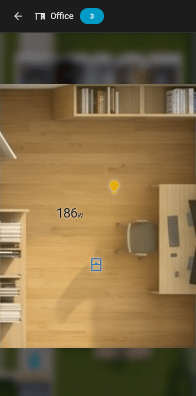
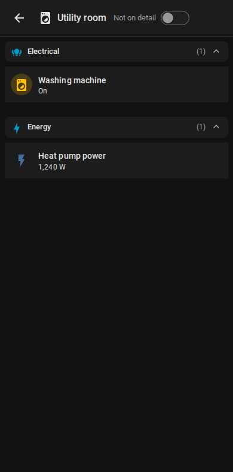

# Scalable House Plan

**Your floor plan as a live, tappable map of your home.** Scalable House Plan is a Home Assistant Lovelace card. You give it a picture of your floor plan and outline the rooms on it; the card puts lights, sensors, doors, windows, thermostats and cameras where they really are, colours each room by what is happening in it, and opens a room in detail when you tap it.

{ .shot }

*Willow Lane, the demo house used throughout this manual: the hallway and kitchen lights are on, a bedroom window is open and someone is in the living room.*

## What it does

- **The whole house at a glance.** The plan scales to fit the card. Every room carries the things that matter in it: light icons, temperatures, door and window bars with the time since they last changed, motion with a live counter.
- **Rooms that light up.** A room glows when there is motion, its lights are on or only ambient lights are on, each in its own colour ([dynamic room colours](concepts/dynamic-colors.md)).
- **A room in detail.** Tap a room to open it full size, with the same elements larger and more of them. A badge counts the room's other entities, which open as standard Home Assistant tiles ([views](concepts/views.md)).
- **Built from your areas.** Give a room a Home Assistant area and it takes the area's name, icon and entities ([rooms and areas](concepts/rooms-and-areas.md)).
- **Fifteen element types,** from simple state icons to a thermostat control, gate buttons and grouped elements ([elements](elements/index.md)).
- **Rooms as dashboards.** A room can render as a dark screen panel for readings and badges ([rooms as dashboards](dashboards.md)).
- **Made for phones and wall tablets.** Pinch to zoom, phone-sized detail views and updates throttled to once a second so a busy house doesn't slow the tablet down.

{ .shot }

{ .shot }

## Where to start

- New here? [Install the card](getting-started/install.md) and [build your first plan](getting-started/first-plan.md).
- Want to see it working first? [Try the demo](demo.md): Willow Lane's picture and complete configuration are ready to copy.
- Looking for an option? See the [reference](reference/index.md).
